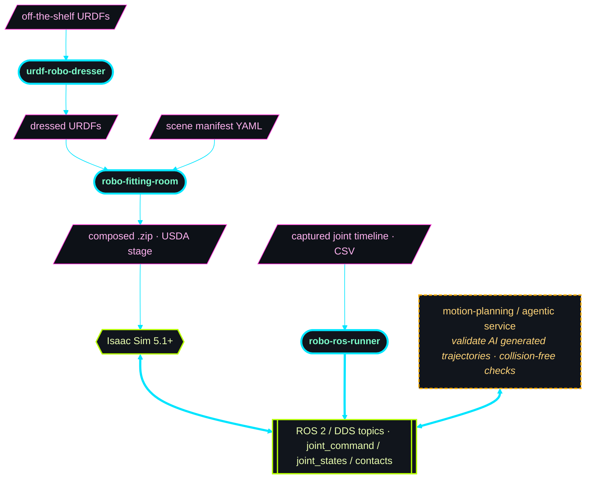
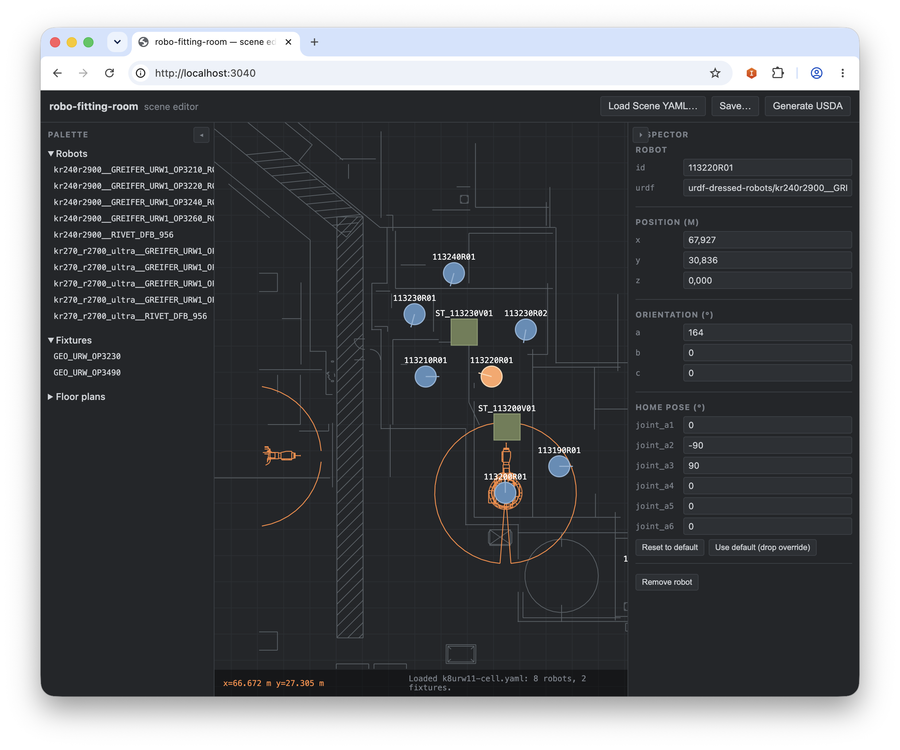
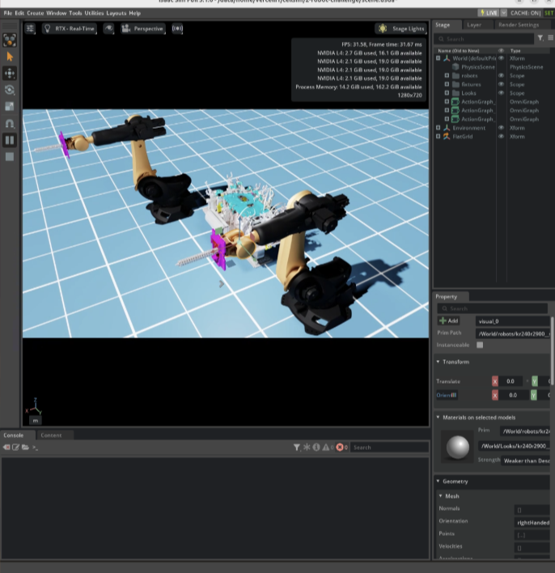

robotic-cellsim-tools
=====================

A set of standalone Rust binaries for assembling, validating, and driving
simulation scenes of multi-robot industrial cells in Isaac Sim. Inputs are
off-the-shelf URDFs; outputs are Isaac Sim 5.1+ USDA stages with
PhysX articulations, ROS 2 topics, and per-link contact telemetry.

> **What's a URDF?** The *Unified Robot Description Format* — the standard XML
> file that describes a robot's links, joints, geometry, and meshes. It's the
> common interchange format across ROS, RViz, MoveIt, and Isaac Sim, so almost
> every robot vendor ships one. These tools take URDFs in and produce
> simulation-ready scenes out.

Each tool is a small, **deterministic** building block: same inputs → byte-stable
outputs, no hidden state, single-responsibility CLIs that also speak a versioned
REST API. They're designed to be composed by higher-level automation — agentic
skills, MCP servers, or planning services — that need reliable, scriptable
primitives to dress robots, compose cells, and drive simulations rather than
opaque, one-shot black boxes.



Every binary ships two modes: a one-shot CLI and a long-running REST
server (with an embedded 2D scene editor in `robo-fitting-room`).
Default `cargo build` produces both — pick the mode at invocation
time. `robo-ros-runner` replays a captured joint-angle timeline onto the
cell's ROS 2 `joint_command` topics, driving the robots in a running sim.

---

## Prerequisites

- **Rust 1.75+** — install via [rustup.rs](https://rustup.rs).
- **Robot & tool URDFs** — you bring your own. The toolchain is asset-agnostic:
  point it at any catalogue of `.urdf` files (with their referenced meshes) laid
  out in the [expected directory shape](#repo-layout). The `assets/` tree here is
  vendor-specific and does **not** ship with the repo.
- **Isaac Sim 5.1+** — only for loading and driving the composed scene at
  runtime. Building, dressing, and composing need nothing but Rust.
- **CSV joint captures** (for `robo-ros-runner` only) — a timeline of recorded
  joint angles per axis over time (e.g. exported from a real robot's PROFINET
  capture), which R3 replays onto the cell. Bring your own; none ship with the
  repo.
- **No native deps.** No USD, PhysX, or Python toolchains — the whole workspace
  builds in ~3 minutes on a stock laptop.

---

## Build first

Build the binaries before running anything — each tool's commands invoke the
compiled binary under its crate's `target/release/`. See each tool's README
(linked below) for full usage.

Keep all downloaded crates and build caches inside the repo by pointing
`CARGO_HOME` at the repo root (handy for sandboxed/offline checkouts and easy
cleanup — the repo's `.gitignore` already excludes `.cargo/` and `target/`):

```sh
git clone <this repo>
cd robotic-cellsim-tools
export CARGO_HOME="$PWD/.cargo"          # vendor crates + caches under the repo

cargo build --release --manifest-path urdf-robo-dresser/Cargo.toml
cargo build --release --manifest-path robo-fitting-room/Cargo.toml
cargo build --release --manifest-path robo-ros-runner/Cargo.toml
# robo-ros-runner needs no feature flags — ROS 2 / DDS + server are core
```

The default build ships both the CLI and the REST server in each binary; pass
`--no-default-features` for the slim CLI-only profile.

---

## The tools at a glance

Each tool stands alone — reach for the one that matches your task, or chain
them for the full URDF → Isaac → ROS 2 pipeline. Every tool has a deep-dive
README linked below.

### `urdf-robo-dresser` — merge a robot arm with an end-effector tool

Takes a bare robot URDF and a tool URDF, auto-detects the flange, computes the
correct mounting orientation, generates convex-hull collision geometry, and
writes a single self-contained **dressed URDF**. One-shot `dress`, catalogue-wide
`batch`, plus `validate` / `list` and a `serve` REST mode.

```sh
urdf-robo-dresser dress --robot robot.urdf --tool gripper_tool.urdf --output dressed.urdf
```

| Robot input | Dressed result |
|---|---|
|  |  |

→ [urdf-robo-dresser/README.md](urdf-robo-dresser/README.md)

### `robo-fitting-room` — compose a multi-robot cell into an Isaac stage

Reads a YAML manifest + dressed URDFs + a 2D floor plan and emits a
self-contained `.zip` with an inlined USDA stage — PhysX articulations, ROS 2
ActionGraphs, and per-link contact sensors, ready to load in Isaac Sim 5.1+.
Drive it from the CLI (`compose` / `validate`) or from the embedded 2D
drag-and-drop scene editor in `serve` mode.

```sh
robo-fitting-room serve --asset-root ./assets   # then open http://localhost:3040/
```

| 2D scene-layout editor | Composed cell in Isaac Sim |
|---|---|
|  |  |

→ [robo-fitting-room/README.md](robo-fitting-room/README.md)

### `robo-ros-runner` — replay a captured timeline onto the live sim

Replays a captured joint-angle timeline (CSV — e.g. a KUKA PROFINET capture)
onto the cell's ROS 2 `joint_command` topics, driving the robots in a running
Isaac Sim. Applies a configurable per-axis deg→rad mapping so raw vendor
captures don't slam into URDF joint limits. `dry-run` previews the publishes;
`run` speaks DDS for real.

```sh
robo-ros-runner dry-run --cell demo-cell.yaml --csv joint_angles_timeline.csv --once
```

→ [robo-ros-runner/README.md](robo-ros-runner/README.md)

---

## Repo layout

```
robotic-cellsim-tools/
├── README.md                       ← this file
├── IDEA.md                         ← original design notes
├── urdf-robo-dresser/              ← Rust crate: URDF merger
├── robo-fitting-room/              ← Rust crate: scene composer
│   ├── REQUIREMENTS.md             ← FR/NFR tracker (single source of progress)
│   └── web/                        ← embedded 2D editor SPA
├── robo-ros-runner/                ← Rust crate: CSV → ROS 2 joint_command replay (R3)
│   ├── REQUIREMENTS.md             ← FR/NFR tracker (single source of progress)
│   └── r3-run.example.yaml         ← sample run config
└── assets/
    ├── urdf-robot-collection/      ← bare robot URDFs (vendor-specific)
    ├── urdf-tool-collection/       ← bare tool URDFs (vendor-specific)
    ├── urdf-fixture-collection/    ← static cell fixtures (vendor-specific)
    ├── urdf-dressed-robots/        ← outputs of `dress` / `batch`
    ├── floor-plans/                ← 2D CAD exports (DXF→OBJ)
    ├── fitted-robots/              ← scene manifest YAMLs (e.g. demo-cell.yaml)
    └── data-captures/              ← joint-angle timeline CSVs + ros-topics.txt
```

`assets/` contents are vendor-specific and won't ship with the
open-source release. The toolchain is asset-agnostic — point it at any
catalogue with the same directory shape.

---

## Documentation

Each crate's `docs/` is the in-depth reference:

- **robo-fitting-room** —
  [README](robo-fitting-room/README.md) ·
  [CLI reference](robo-fitting-room/docs/cli.md) ·
  [REST API](robo-fitting-room/docs/api.md) ·
  [Concepts](robo-fitting-room/docs/concepts.md) ·
  [Manifest schema](robo-fitting-room/docs/manifests.md) ·
  [USDA layout](robo-fitting-room/docs/usda.md) ·
  [`openapi.json`](robo-fitting-room/openapi.json) ·
  [Requirements tracker](robo-fitting-room/REQUIREMENTS.md)
- **urdf-robo-dresser** —
  [README](urdf-robo-dresser/README.md) ·
  [CLI reference](urdf-robo-dresser/docs/cli.md) ·
  [REST API](urdf-robo-dresser/docs/api.md) ·
  [Concepts](urdf-robo-dresser/docs/concepts.md) ·
  [`openapi.json`](urdf-robo-dresser/openapi.json) ·
  [Requirements tracker](urdf-robo-dresser/REQUIREMENTS.md)
- **robo-ros-runner** —
  [README](robo-ros-runner/README.md) ·
  [CLI reference](robo-ros-runner/docs/cli.md) ·
  [REST API](robo-ros-runner/docs/api.md) ·
  [Concepts](robo-ros-runner/docs/concepts.md) ·
  [`openapi.json`](robo-ros-runner/openapi.json) ·
  [Requirements tracker](robo-ros-runner/REQUIREMENTS.md)

