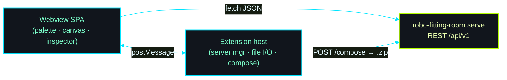

# robo-fitting-room — VS Code extension

Hosts the [`robo-fitting-room`](../robo-fitting-room/) 2D scene-layout
editor inside a VS Code webview, talking to the tool's in-binary REST
server. It's the same drag-drop editor you get at `http://localhost:3040/`,
but embedded in the IDE with native file dialogs and disk writes instead
of browser downloads.



## How it works

The webview renders the editor and calls the server's stable
`/api/v1/*` endpoints directly for the small JSON operations (list
assets, parse URDF joints, parse floor plans, validate, save the
manifest). Because the webview lives on the `vscode-webview://` origin,
it uses the absolute server URL injected by the extension; the server's
permissive CORS layer allows those cross-origin calls.

Three things that don't map cleanly onto a webview are delegated to the
extension host over `postMessage`:

| Action | Webview limitation | Handled by host with |
|---|---|---|
| **Load Scene YAML** | no real file picker | `showOpenDialog` + read file |
| **Save…** | `window.prompt` unavailable | `showInputBox`, then server save |
| **Export Bundle…** | can't write a folder tree | host `fetch` + folder picker + `unzip` |
| **Generate USDA** | 100 MB+ zip can't round-trip | host `fetch` + `showSaveDialog` + write |

The compose zip is fetched and written by the Node host, so large
archives never pass through the webview.

### Save vs Export vs Generate

- **Save…** writes just the scene *manifest YAML* to the server's
  `fitted-robots/` directory. It records paths, not the URDFs themselves.
- **Export Bundle…** writes the self-contained source tree — `scene.yaml`
  (relative paths) + `robots/` + `fixtures/` + `floorplans/`, each URDF
  with its `meshes/` — as an extracted `<name>-urdf/` folder under a
  directory you pick. Hits `/api/v1/compose-urdf-bundle` and unpacks with
  the system `unzip` (falls back to saving the `.zip` if `unzip` is
  missing).
- **Generate USDA** composes the Isaac-Sim-ready USDA stage zip (with an
  optional URDF bundle checkbox).

## Commands

- **robo-fitting-room: Open Scene Editor** — opens the editor panel;
  offers to start the server if none is reachable.
- **robo-fitting-room: Start Server** / **Stop Server** — manage a
  `robo-fitting-room serve` child process from inside VS Code.
- **robo-fitting-room: Open Swagger Docs in Browser** — opens `/docs`.

A status-bar item shows whether a server is reachable.

## Settings

| Setting | Default | Purpose |
|---|---|---|
| `roboFittingRoom.serverUrl` | `http://localhost:3040` | Base URL of the REST server the editor talks to |
| `roboFittingRoom.binaryPath` | `robo-fitting-room` | Binary used by *Start Server* (PATH by default) |
| `roboFittingRoom.assetRoot` | *(empty)* | `--asset-root` for the managed server; prompted if unset |
| `roboFittingRoom.serverHost` | `127.0.0.1` | `--host` for the managed server |
| `roboFittingRoom.serverPort` | `3040` | `--port` for the managed server |
| `roboFittingRoom.webRoot` | *(empty)* | Optional `--web-root` for live SPA editing |

## Develop / run

```sh
npm install
npm run compile        # or: npm run watch
```

Press **F5** (Run Extension) to launch an Extension Development Host.
Then run **robo-fitting-room: Open Scene Editor** from the command
palette.

You need the `robo-fitting-room` binary built with the server feature:

```sh
cd ../robo-fitting-room
cargo build --release --features server
```

Point `roboFittingRoom.binaryPath` at
`../robo-fitting-room/target/release/robo-fitting-room` (or put it on
your PATH), set `roboFittingRoom.assetRoot` to your `assets/` directory,
and use **Start Server**. Or run the server yourself and just point
`roboFittingRoom.serverUrl` at it.

## Packaging

Build an installable `.vsix`:

```sh
./build-vsix.sh              # produces robo-fitting-room-vscode-<version>.vsix
./build-vsix.sh --install    # also installs it via the `code` CLI
```

The script runs `npm install`, compiles, and packages with
`npx @vscode/vsce package --no-dependencies` (nothing global to
install). `js-yaml`, used for manifest round-tripping in the webview,
is vendored as a static asset at `media/vendor/js-yaml.min.js`, so the
package carries no runtime `node_modules`.

Install manually instead: VS Code → Extensions → `…` → **Install from
VSIX…**, or `code --install-extension <file>.vsix`.
