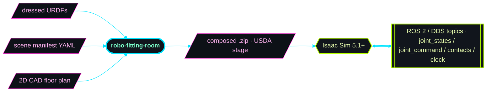

# robo-fitting-room

Pure-Rust scene composition engine for multi-robot industrial cells.
Takes a YAML manifest + dressed URDFs (from
[`urdf-robo-dresser`](../urdf-robo-dresser/)) + a 2D CAD floor plan,
emits a self-contained `.zip` with an inlined ASCII USDA stage ready
to load in Isaac Sim 5.1+. CLI for offline / scripted use; in-binary
REST server with a 2D scene-layout editor for interactive workflows.



No native USD, PhysX, or Python deps — `cargo build` on a clean
checkout in ~3 minutes.

## Install

```sh
cargo build --release                          # CLI + REST server
cargo build --release --no-default-features    # CLI only
```

The default build ships both modes in one binary.

## Quick start — CLI

```sh
# Validate a manifest
./target/release/robo-fitting-room validate \
    ../assets/fitted-robots/demo-cell.yaml

# Compose the demo 8-robot cell into a zip
./target/release/robo-fitting-room compose \
    --manifest ../assets/fitted-robots/demo-cell.yaml \
    --output   /tmp/demo-cell.zip
```

In Isaac Sim 5.1+, `unzip` and **File → Open** the `.usda`. Hit Play;
the 8 robots load stowed in their home pose, ROS 2 topics start
publishing.

### Also emit a URDF source bundle

Pass `--urdf-bundle` to write a **second** zip next to the USDA one: a
self-contained package of the scene's *source* URDFs — every dressed
URDF copied byte-for-byte (each in its own folder with its `meshes/`
subtree), the floor-plan OBJ, and the scene YAML rewritten to reference
them by relative path. Extract it anywhere and it stands alone. The
USDA output is unchanged.

```sh
# Compose the 2-robot challenge cell, USDA zip + URDF source bundle
./target/release/robo-fitting-room compose \
    --manifest ../assets/fitted-robots/scene.yaml \
    --output   ../assets/fitted-robots/2-robot-challenge.zip \
    --urdf-bundle
```

The bundle path is derived from `--output` by inserting a `-urdf`
suffix, so this run produces two files in `assets/fitted-robots/`:

```
2-robot-challenge.zip        # USDA stage (inlined) + manifest
2-robot-challenge-urdf.zip   # scene.yaml + robots/ + fixtures/ + floorplans/
```

```
Written: ../assets/fitted-robots/2-robot-challenge.zip (2 robots, 1 fixtures, 5557 floor-plan segments)
  Zip: 21192514 bytes (usda: 104369838 bytes)
Bundling source URDFs → ../assets/fitted-robots/2-robot-challenge-urdf.zip ...
Written: ../assets/fitted-robots/2-robot-challenge-urdf.zip (1 robot URDFs, 1 fixture URDFs, 1824 files, floor plan: yes)
  Bundle zip: 20433974 bytes
```

Both robots in this scene share one dressed URDF, so the bundle
deduplicates them into a single `robots/kr240r2900__sticktool/` folder.
The extracted `2-robot-challenge-urdf.zip` layout — `robots/`,
`fixtures/`, and `floorplans/` at the top level, one subfolder per item:

```
2-robot-challenge-urdf/
├── scene.yaml                                   # paths rewritten: robots/… fixtures/… floorplans/…
├── robots/kr240r2900__sticktool/               # deduped robot (referenced by both R1 and R2)
│   ├── kr240r2900__sticktool.urdf
│   └── meshes/{robot,tool}/…
├── fixtures/GEO_URW_OP3230/
│   ├── GEO_URW_OP3230.urdf
│   └── meshes/…
└── floorplans/k8urw11-floor-plan/
    └── k8urw11-floor-plan.obj
```

In the 2D editor, the **Generate USDA** dialog exposes an equivalent
*"Also download URDF source bundle"* checkbox; over REST it's a
separate `POST /api/v1/compose-urdf-bundle?manifest_path=…` streaming
the bundle zip.

## Quick start — server + 2D editor

```sh
./target/release/robo-fitting-room serve --asset-root ../assets
# open http://localhost:3040/        2D scene-layout editor
# open http://localhost:3040/docs    Swagger UI
```

Drag robots and fixtures from the palette onto the floor plan, set
per-robot home poses in the inspector, click **Generate USDA** to
download a recomposed zip.


## Visual fidelity matrix

The compose pass has two independent fidelity flags that control which
mesh prims are emitted. Articulation behaviour is identical across all
combinations.

| `--full-robots` | `--full-tools` | Zip size (demo cell) | Inline meshes | Viewport |
|---|---|---:|---:|---|
| false (default) | true (default) | 113 MB | 14498 | Robot collision hulls + tool visuals |
| false | false | 43 MB | 8809 | Robot + tool collision hulls only |
| true | true | 122 MB | 14554 | Full robot + full tool visuals |
| true | false | mixed | — | Full robot visuals + tool hulls |

Per-link tool/robot detection works off the `meshes/{robot,tool}/`
path prefix that `urdf-robo-dresser` writes.

## Documentation

- [`docs/cli.md`](docs/cli.md) — every subcommand with worked examples
- [`docs/api.md`](docs/api.md) — REST API reference, curl recipes
- [`docs/concepts.md`](docs/concepts.md) — manifest, dressed URDF, articulation root, contact graphs, topic schema
- [`docs/manifests.md`](docs/manifests.md) — manifest schema reference
- [`docs/usda.md`](docs/usda.md) — what gets emitted in the USDA + per-prim path table
- [`docs/ros2-windows.md`](docs/ros2-windows.md) — Pixi + bundled-DDS Windows walkthrough
- [`openapi.json`](openapi.json) — checked-in OpenAPI 3.x spec
- [REQUIREMENTS.md](REQUIREMENTS.md) — FR/NFR tracker, `tests/requirements.rs` is 1:1 with this file

## Status

What's shipped:

- Manifest parsing + validation; multi-robot scene composition
- URDF → USD conversion with PhysX articulations, FK home pose, steel-arm inertia overrides
- Per-robot ROS 2 ActionGraphs (joint state pub/sub, articulation controller)
- Per-link contact sensors → `std_msgs/Bool` topics
- PhysX scene tuning, GPU broadphase capacities, deterministic zip output
- Versioned REST API at `/api/v1/*`, OpenAPI 3.x spec, healthz/readyz, Cyclone DDS conformance
- 2D scene-layout editor SPA embedded in the binary

What's planned (per [REQUIREMENTS.md](REQUIREMENTS.md)):

- `monitor` subcommand for collision fan-out (FR-164..169)
- Spatial validation: FK reach envelopes, static collision detection (FR-130..133)
- Isaac Sim live-deploy via Kit Remote (FR-170..177)
- MuJoCo / Gazebo backends (BL-04 / BL-05)
