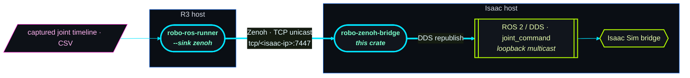

# robo-zenoh-bridge

Subscribes [`robo-ros-runner`](../robo-ros-runner) (R3) joint commands over
**Zenoh** and republishes them onto **Isaac Sim's local ROS 2 / DDS**. Run it
**on the Isaac host**.

## Why this exists

R3's DDS transport discovers Isaac via **multicast** — which works on a shared
LAN but is silently dropped across an AWS VPC (two EC2 instances). This bridge
gives you the missing path: R3 publishes over **Zenoh TCP unicast to an explicit
IP** (this host), and the bridge republishes onto DDS over **loopback**, where
Isaac's ROS 2 bridge is already subscribed. No multicast between hosts, no
`ROS_DOMAIN_ID` guesswork across the network — just a TCP connection.



Pure Rust, TCP-only Zenoh — **no C toolchain** (no clang/cmake). Just a Rust
toolchain and `cargo`.

## Quickstart

```sh
# 1. On the Isaac host: clone the repo and build+run the bridge (zero args).
git clone <repo> && cd sample-robotic-cellsim-tools/robo-zenoh-bridge
cargo run                # listens tcp/0.0.0.0:7447, republishes to DDS domain 0

# 2. The bridge prints the exact line to paste on the R3 host, e.g.:
#      robo-ros-runner run --cell <cell.yaml> --csv <capture.csv> \
#          --sink zenoh --zenoh-connect tcp/10.0.1.50:7447 --zenoh-key-prefix r3

# 3. On the R3 host: run that line (point --zenoh-connect at THIS host's IP).
```

## Flags (all optional)

| Flag | Default | Meaning |
|------|---------|---------|
| `--listen <ep>` | `tcp/0.0.0.0:7447` | Zenoh listen endpoint(s); repeatable. |
| `--domain <u32>` | `0` | `ROS_DOMAIN_ID` to republish onto (Isaac's domain). |
| `--key-prefix <s>` | `r3` | Key-expr prefix; **must match** R3's `--zenoh-key-prefix`. |

## Networking (two-EC2 topology)

- Open inbound **TCP 7447** on the Isaac host's security group, sourced from the
  R3 host's security group (use private IPs).
- Zenoh multicast scouting is **disabled** — discovery is explicit TCP unicast,
  so it crosses the VPC.
- The DDS republish uses loopback multicast, which works because the bridge and
  Isaac share one host. Keep `--domain` matched to Isaac's `ROS_DOMAIN_ID`.

## How it works

R3's `ZenohSink` and this bridge share one wire contract, defined once in
`robo_ros_runner::transport::zenoh` (imported here so it can't drift):

- **Key expr**: `/<cell>/<robot>/joint_command` → `r3/<cell>/<robot>/joint_command`
  (prefix + strip leading `/`). The bridge subscribes `r3/**`.
- **Payload**: `serde_json` of `ZenohJointCommand { topic, names, positions,
  sec, nanosec }`. The topic in the payload is authoritative; the key expr
  carries it too as a cross-check.

The bridge decodes each sample, rebuilds a `JointCommand`, and calls
`Ros2ClientSink::publish_joint_command`, which auto-creates a DDS publisher per
topic on first sight.
