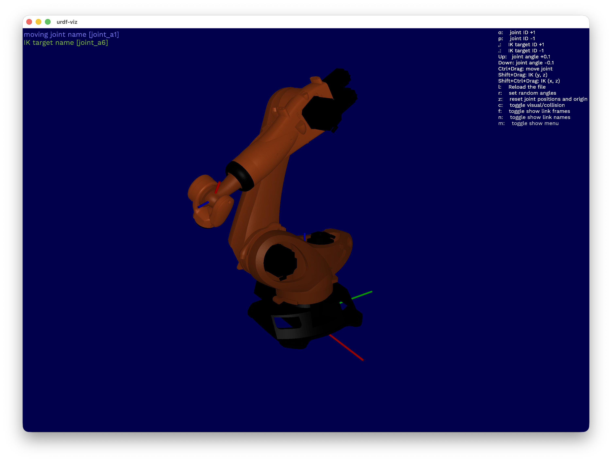
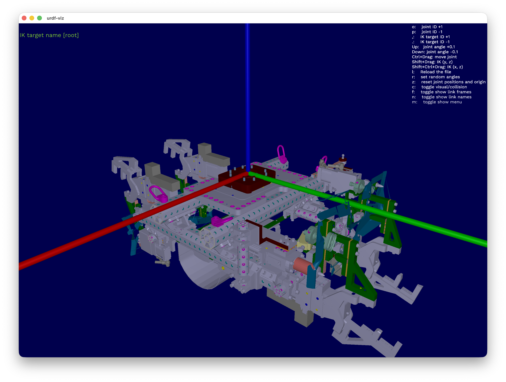
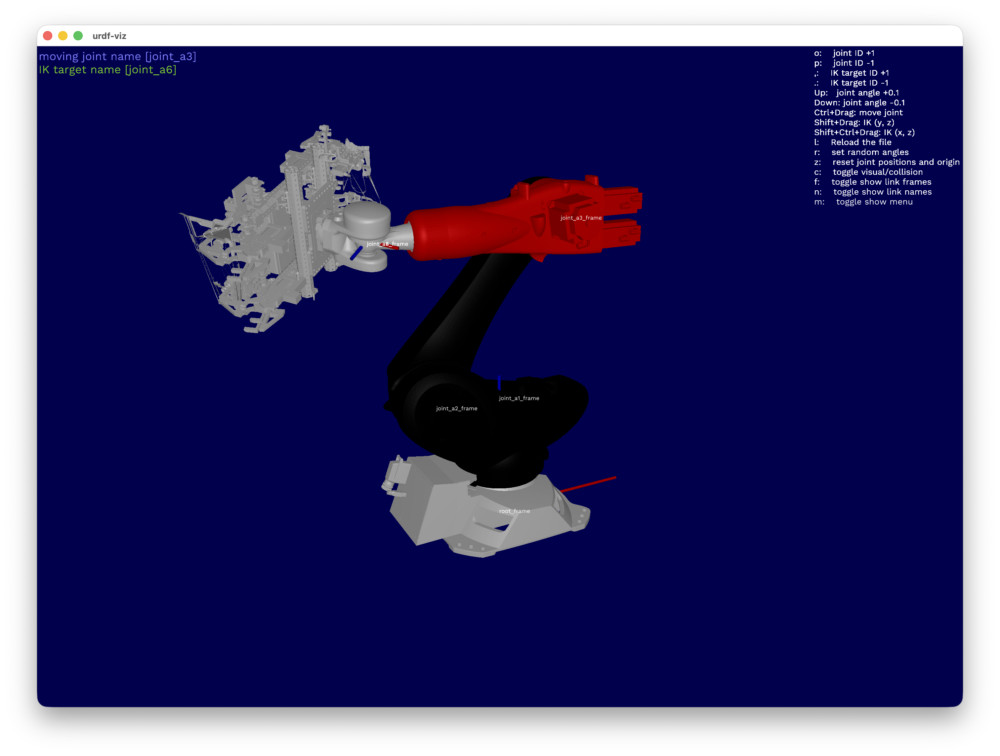
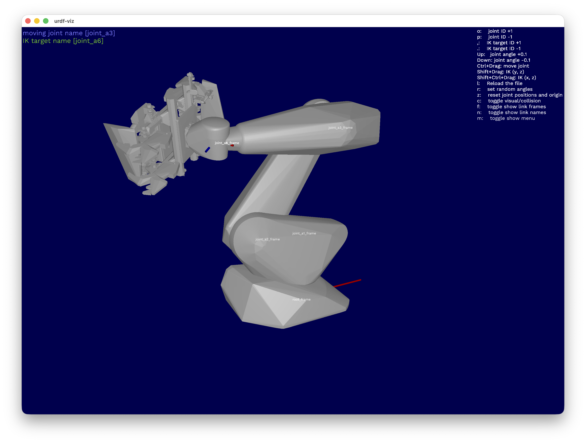

# urdf-robo-dresser

Programmatic URDF robot-tool merging for industrial automation. Takes a robot arm and an end-effector tool from a structured asset catalogue, automatically determines the correct mounting orientation, generates collision geometry, and produces a self-contained dressed URDF ready for simulation in Isaac Sim, RViz, or MoveIt.

---

## Quick Start

### Prerequisites

- Rust toolchain (1.75+): https://rustup.rs
- urdf-viz (for visualization): `cargo install urdf-viz`

### Build

```sh
cd cellsim/urdf-robo-dresser
cargo build --release
```

The binary is at `target/release/urdf-robo-dresser`.

Default `cargo build` ships **both** the CLI and the REST server.
Pass `--no-default-features` for the slim CLI-only profile.

---

## Documentation

| File | What |
|------|------|
| [`docs/cli.md`](docs/cli.md) | Full CLI reference for every subcommand |
| [`docs/api.md`](docs/api.md) | REST API: endpoints, error envelope, batch job lifecycle |
| [`docs/concepts.md`](docs/concepts.md) | Catalogue layout, auto-orient algorithm, hull buffers, merge semantics |
| [`openapi.json`](openapi.json) | Machine-readable wire schema (also served at `/openapi.json`) |
| [`REQUIREMENTS.md`](REQUIREMENTS.md) | FR/NFR tracker (each row links to the implementing source) |

---

## Example Walkthrough

### Step 1: Inspect the inputs

| Robot | Tool |
|-------|------|
|  |  |
| `urdf-viz assets/urdf-robot-collection/kr240r2900/kr240r2900.urdf` | `urdf-viz assets/urdf-tool-collection/gripper_tool/gripper_tool.urdf` |
| 6-DOF robot arm. The last joint defines the end-effector flange. | Gripper tool. Origin (0,0,0) is at the mounting flange center. |

### Step 2: Dress the robot

```sh
urdf-robo-dresser dress \
  --robot assets/urdf-robot-collection/kr240r2900/kr240r2900.urdf \
  --tool assets/urdf-tool-collection/gripper_tool/gripper_tool.urdf \
  --output assets/urdf-dressed-robots/test/test.urdf \
  --view
```

Output:

```
[INFO  urdf_robo_dresser::collision] Generated 950 collision hulls for link 'World' (Medium)
[INFO  urdf_robo_dresser::collision] Generated 1 collision hulls for link 'like_kr240r2900_base_link' (Medium)
[INFO  urdf_robo_dresser::collision] Generated 1 collision hulls for link 'like_kr240r2900_link_1' (Medium)
[INFO  urdf_robo_dresser::collision] Generated 1 collision hulls for link 'like_kr240r2900_link_2' (Medium)
[INFO  urdf_robo_dresser::collision] Generated 1 collision hulls for link 'like_kr240r2900_link_3' (Medium)
[INFO  urdf_robo_dresser::collision] Generated 1 collision hulls for link 'like_kr240r2900_link_4' (Medium)
[INFO  urdf_robo_dresser::collision] Generated 1 collision hulls for link 'like_kr240r2900_link_5' (Medium)
[INFO  urdf_robo_dresser::collision] Generated 1 collision hulls for link 'like_kr240r2900_link_6' (Medium)
[INFO  urdf_robo_dresser::merger] Auto-orient: picked [90, 180, 90] (normal_dot=0.910, centroid_outward=0.190)
Dressed URDF written to assets/urdf-dressed-robots/test/test.urdf
Opening urdf-viz...
```

The tool orientation was determined automatically. The viewer opens immediately for inspection.

### Step 3: Inspect the result

| Visual Mode | Collision Hulls (press `c`) |
|-------------|----------------------------|
|  |  |
| Tool is merged into the end-effector link. All joints remain interactive. | Per-component convex hulls for both robot and tool. Medium buffer (5%). |

### Output Folder

The output is fully self-contained — all meshes are copied into the output directory:

```
assets/urdf-dressed-robots/test/
├── test.urdf                          # dressed URDF (robot + tool merged)
└── meshes/
    ├── robot/                         # robot link meshes + collision hulls
    │   ├── *_visuals_*.obj
    │   ├── *_hull_0.obj
    │   └── ...
    └── tool/                          # tool component meshes + collision hulls
        ├── *.obj                      # original visual meshes
        ├── World_hull_0.obj           # per-component convex hulls
        ├── World_hull_1.obj
        └── ... (one hull per visual component)
```

---

## Commands

### `dress` — Merge a single robot with a tool

The core operation. Parses both URDFs, auto-detects the flange link, computes the correct tool orientation, generates collision hulls, and writes a single merged URDF.

```sh
urdf-robo-dresser dress \
  --robot <ROBOT_URDF> \
  --tool <TOOL_URDF> \
  --output <OUTPUT_PATH> \
  [--orient <X,Y,Z>] \
  [--hull <tight|medium|max>] \
  [--attach-to <LINK_NAME>] \
  [--view]
```

**Flags:**

| Flag | Default | Description |
|------|---------|-------------|
| `--orient` | auto | Override tool orientation (degrees, multiples of 90). Format: `x,y,z` e.g. `0,90,180`. When not specified or set to `0,0,0`, auto-orient runs. |
| `--hull` | `medium` | Collision hull inflation. `tight` = exact fit, `medium` = 5% buffer, `max` = 15% buffer. |
| `--attach-to` | auto | Override flange link detection. By default the deepest leaf link in the kinematic chain is used. |
| `--view` | off | Open urdf-viz after dressing for visual inspection. |

**What happens internally:**

1. Parse robot and tool URDFs into typed kinematic trees
2. Validate both (check for cyclic graphs, dangling refs, missing meshes)
3. Auto-detect the flange link (deepest leaf in robot's kinematic chain)
4. Generate per-component convex hull collision geometry for both robot and tool
5. Determine tool orientation via 3-stage scoring (64 candidates tested)
6. Inject tool geometry into the flange link with the computed rotation
7. Copy all mesh files (visual + hulls) into the output directory
8. Write deterministic output URDF with rewritten mesh paths

---

### `batch` — Generate all robot×tool combinations

Scans a structured asset catalogue and produces dressed URDFs for every valid robot+tool permutation.

```sh
urdf-robo-dresser batch \
  --catalogue <CATALOGUE_DIR> \
  --output <OUTPUT_DIR> \
  [--hull <tight|medium|max>]
```

**Expected catalogue structure:**

```
catalogue/
├── urdf-robot-collection/
│   ├── robot_a/
│   │   ├── robot_a.urdf
│   │   └── meshes/
│   └── robot_b/
│       ├── robot_b.urdf
│       └── meshes/
└── urdf-tool-collection/
    ├── TOOL_1/
    │   ├── TOOL_1.urdf
    │   └── meshes/
    └── TOOL_2/
        ├── TOOL_2.urdf
        └── meshes/
```

**Output:**

```
output/
├── robot_a__TOOL_1/
│   ├── robot_a__TOOL_1.urdf
│   └── meshes/
├── robot_a__TOOL_2/
│   ├── robot_a__TOOL_2.urdf
│   └── meshes/
├── robot_b__TOOL_1/
│   └── ...
└── robot_b__TOOL_2/
    └── ...
```

Each combination gets its own folder with a self-contained URDF and all meshes.

**Example:**

```sh
urdf-robo-dresser batch --catalogue assets/ --output assets/urdf-dressed-robots/
```

```
Found 1 robot(s) and 4 tool(s)
[INFO] Auto-orient: picked [270, 180, 270] (normal_dot=0.935)
  kr240r2900__gripper_tool_a -> .../kr240r2900__gripper_tool_a.urdf
[INFO] Auto-orient: picked [90, 0, 180] (normal_dot=0.840)
  kr240r2900__gripper_tool_b -> .../kr240r2900__gripper_tool_b.urdf
[INFO] Auto-orient: picked [0, 270, 180] (normal_dot=0.840)
  kr240r2900__gripper_tool_c -> .../kr240r2900__gripper_tool_c.urdf
[INFO] Auto-orient: picked [90, 180, 90] (normal_dot=0.910)
  kr240r2900__gripper_tool_d -> .../kr240r2900__gripper_tool_d.urdf

Batch complete: 4 success, 0 failed
```

---

### `validate` — Check a URDF for correctness

Runs structural validation without producing output. Useful for CI/CD or pre-flight checks.

```sh
urdf-robo-dresser validate <URDF_PATH> [--tool]
```

**Checks performed:**

- Kinematic tree is acyclic (proper tree, single root)
- All parent/child link references resolve
- No duplicate link or joint names
- Joint limits consistency (lower < upper)
- Mesh file existence (all referenced `.obj`/`.stl` files exist)
- Collision coverage (warns if visual geometry has no collision)
- Tool origin alignment (`--tool` flag: checks 0/0/0 is at flange center)

**Example:**

```sh
urdf-robo-dresser validate assets/urdf-robot-collection/kr240r2900/kr240r2900.urdf
# Valid URDF: 8 links, 7 joints

urdf-robo-dresser validate --tool assets/urdf-tool-collection/gripper_tool/gripper_tool.urdf
# Valid URDF: 1 links, 0 joints
```

Exit code 0 = valid, non-zero = errors found.

---

### `serve` — REST API + Swagger UI

Boot the same operations as a versioned HTTP service.

```sh
urdf-robo-dresser serve --catalogue assets
# REST + Swagger UI on http://localhost:3030
```

| Path | What |
|------|------|
| `/` | Landing page |
| `/docs` | Swagger UI |
| `/openapi.json` | OpenAPI 3.x spec |
| `/healthz`, `/readyz` | Liveness + readiness probes |
| `/api/v1/catalogue` | List catalogue robots + tools |
| `/api/v1/dress` | POST `{robot_id, tool_id}`, get a dressed URDF |
| `/api/v1/batch` | Long-running permutation merge → `202` + job id |

```sh
curl -s http://localhost:3030/api/v1/catalogue | jq .

curl -s -X POST http://localhost:3030/api/v1/dress \
    -H "Content-Type: application/json" \
    -d '{"robot_id":"kr240r2900","tool_id":"gripper_tool","hull":"medium"}' \
    | jq .
```

Both transports — CLI and REST — call the same library functions, so
behaviour is identical. See [`docs/api.md`](docs/api.md) for the full
REST reference.

---

## Auto-Orientation Algorithm

When `--orient` is not specified, the tool's correct mounting orientation is determined automatically using a purely geometric approach:

### Stage 1: Direction Alignment

The tool's "pointing direction" (vector from origin 0,0,0 toward the centroid of all visual positions) is compared against the robot's "flange outward direction" (the last joint's rotation axis transformed through the FK chain at home pose).

For each of 64 candidate rotations (0°/90°/180°/270° on each axis), the tool direction is rotated and dotted with the flange outward vector. Higher dot product = better alignment.

### Stage 2: Centroid Outward Check

After rotation, the tool's geometric centroid should be further from the robot base than the flange point itself. This ensures the tool extends outward, not back into the arm.

### Stage 3: AABB Intersection

As a tiebreaker among near-equal candidates, the number of tool mesh vertices that fall inside the robot's axis-aligned bounding box is counted. Fewer intersections = better.

### Scoring

1. Sort candidates by highest `normal_dot` (direction alignment)
2. Among top candidates (within 0.05 of best), prefer those with `centroid_outward > 0`
3. Final tiebreak: lowest intersection count

---

## Collision Hull Generation

Every visual mesh component gets its own convex hull for collision detection. This produces tight-fitting collision geometry suitable for physics simulation.

### How it works

1. For each visual element in both robot and tool, read the OBJ mesh vertices
2. Scale vertices outward from their centroid by the buffer factor
3. Compute the convex hull using the quickhull algorithm (parry3d)
4. Write the hull as an OBJ file in the output meshes directory
5. Replace all original `<collision>` elements with the generated hulls

### Buffer modes

| Mode | Scale Factor | Use Case |
|------|-------------|----------|
| `tight` | 1.0× | Exact mesh boundary. For precision collision checking. |
| `medium` | 1.05× | 5% inflation. Default. Good balance for simulation. |
| `max` | 1.15× | 15% inflation. Generous margin for safety-critical scenarios. |

### Best practices

- Use `medium` (default) for general simulation and motion planning
- Use `tight` when you need precise collision boundaries for clearance checks
- Use `max` when planning safety zones or when mesh quality is low

---

## Tool URDF Requirements

For the auto-orient and merge to work correctly, tool URDFs must follow these conventions:

1. **Origin at docking center** — The URDF origin (0,0,0) must be located at the exact center of the tool's mounting flange interface. This is the point that connects to the robot's end-effector.

2. **Geometry relative to origin** — All visual and collision elements are positioned relative to this docking center using `<origin xyz="..." rpy="...">` attributes.

3. **Directory convention** — Each tool lives in its own directory named after the tool:
   ```
   TOOL_NAME/
   ├── TOOL_NAME.urdf
   └── meshes/
       ├── component_001.obj
       └── ...
   ```

4. **Mesh paths** — Mesh filenames in the URDF should be relative to the URDF file location (e.g. `./meshes/component.obj`).

---

## Environment Variables

| Variable | Effect |
|----------|--------|
| `RUST_LOG=info` | Show auto-orient decisions and hull generation progress |
| `RUST_LOG=debug` | Show tool direction vectors, flange computation details |

---

## Run Tests

```sh
cargo test
```

15 tests covering parser round-trip, validator diagnostics, flange detection, merge correctness, and mesh reading.

---

## License

MIT OR Apache-2.0
